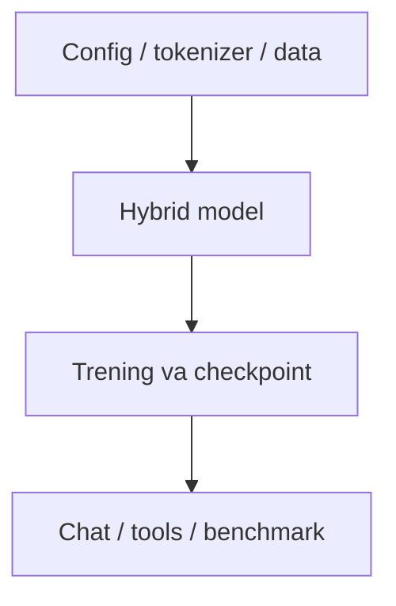

# Moonlight AI — loyiha xaritasi

[README](../README.md) · [Roadmap](../ROADMAP.md) · [Baholash](EVALUATION.md) · [Reliz tartibi](RELEASING.md)

## Maqsad

Model, tokenizer, trening va baholash — bitta kutubxonada.

**Texnologiyalar:** PyTorch · Attention + Retention · BPE.

## Arxitektura va oqim

Asosiy oqimning ixcham xaritasi; batafsil xulq manba kodida berilgan.



## Boshlang‘ich misol

Quyidagi buyruqlarni README dagi talablar va sozlash bosqichlaridan keyin, repozitoriy ildizidan bajaring:

```bash
python -m pip install -e ".[dev]"
moonlight train ml-1m-debug --offline
```

Bu kichik offline smoke trening uchun misol. Natijasi katta chat modelining sifatini isbotlamaydi. Keyingi benchmark va chat uchun saqlangan run/checkpointni ishlating.

Bu qo‘llanma misolni ushbu hujjat yangilanishi vaqtida bajarilgan test sifatida ko‘rsatmaydi. Test dalili, qurilma va natija baholash hisobotida alohida saqlanadi.

## Manba xaritasi

[moonlight/config.py](../moonlight/config.py) · [moonlight/llm.py](../moonlight/llm.py) · [moonlight/model](../moonlight/model) · [moonlight/train](../moonlight/train) · [docs/ARCHITECTURE.md](../docs/ARCHITECTURE.md) · [docs/BENCHMARKS.md](../docs/BENCHMARKS.md)

## Ish jarayoni

1. Lokal yoki test muhitini tayyorlang.
2. Yuqoridagi eng kichik oqimni tekshiring.
3. Ta’sirlangan modulning testini bajaring.
4. Faqat haqiqiy natijalarni hisobotga kiriting.

[Hissa qo‘shish](../CONTRIBUTING.md) · [O‘zgarishlar](../CHANGELOG.md)
